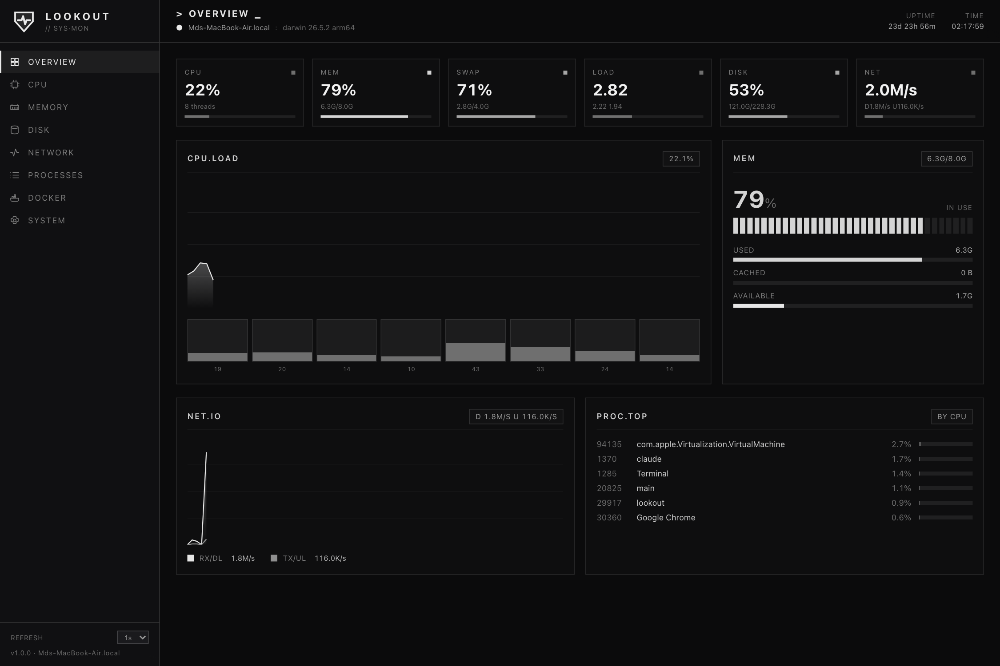
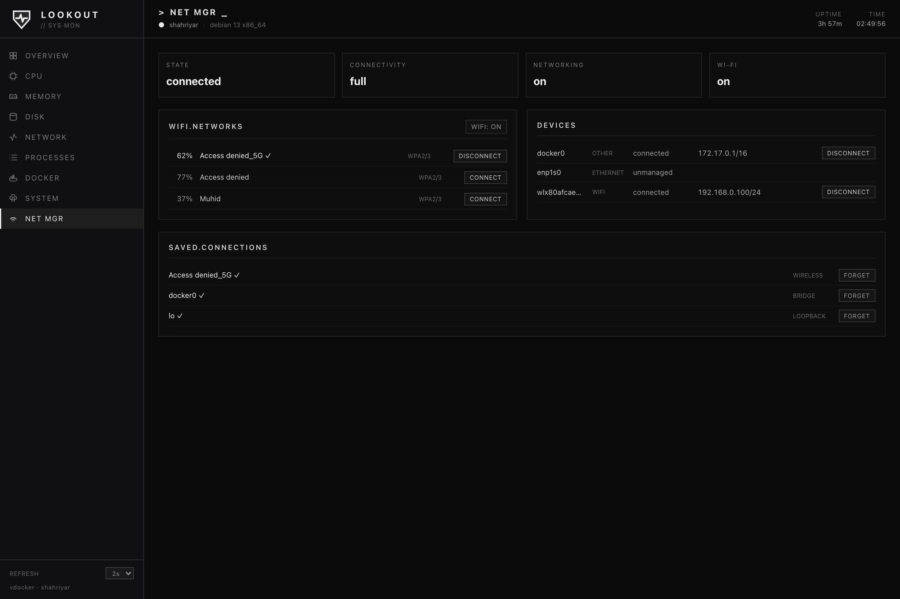
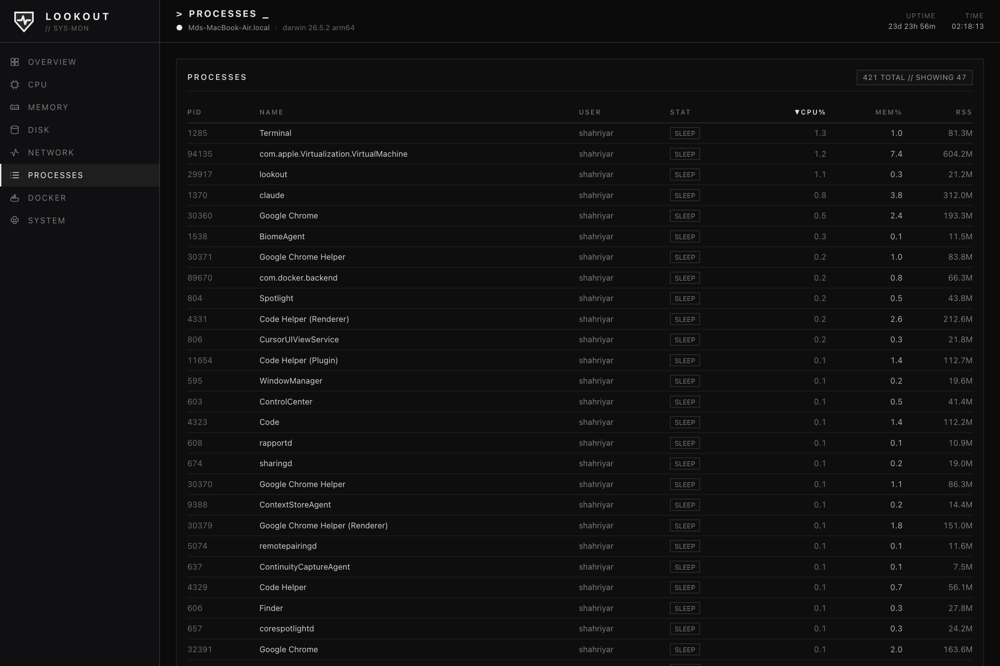

<div align="center">

# LOOKOUT

**A single-binary system monitor with a live, e-ink-style web UI.**

A lightweight, self-hosted alternative to [Glances](https://github.com/nicolargo/glances) — one static Go binary, the whole frontend embedded, real-time metrics streamed over Server-Sent Events. No runtime dependencies, no database, minimal RAM.

</div>



---

## Why "Lookout"?

A *lookout* is the one who keeps watch and raises the alarm — exactly what this does for a machine. The mark is a **shield with a pulse** (guardian + live vitals).

## Design

The UI is a deliberately **monochrome, e-ink dark** theme: flat matte black, high contrast, sharp corners, and **no color** — utilization is shown by *brightness* instead (dim when idle, white under load), so the whole dashboard reads calmly at a glance. Hand-drawn SVG charts and segmented block meters; no chart library.

## Features

- **Single binary.** The entire UI (HTML/CSS/JS) is embedded with `go:embed`. Copy one file to a server and run it.
- **Tiny footprint.** No web framework, no chart library, no database. One background goroutine samples the system; an SSE hub fans that single sample out to every connected browser — **N viewers cost the same as one**. Resident memory ~15 MB.
- **Live streaming.** Metrics push to the browser over Server-Sent Events. The refresh interval (1s / 2s / 5s) is adjustable from the UI and applied server-side.
- **Views:** Overview · CPU (per-core) · Memory · Disk (usage + I/O) · Network (per-interface) · Processes · Docker · System (+ temperature sensors) · **Network Manager**.
- **NetworkManager control** (auto-detected). When NetworkManager is present on the host, a **Net Mgr** tab appears with live status, devices + IPs, Wi-Fi networks (connect with a password, disconnect), a Wi-Fi radio toggle, and saved-connection management (connect / forget). It talks to NM over the system **D-Bus** (via `godbus` — no `nmcli` binary needed) and the whole feature auto-hides where NM isn't running. In Docker it needs the system D-Bus socket mounted (see the compose file); write actions additionally require **polkit** to authorize the caller.


- **Sortable processes.** Click any column (CPU / mem / RSS / PID / name / user). The server streams a candidate pool that is the **union of the top processes by CPU and by RSS**, so sorting by memory surfaces the real memory hogs — not just whatever ranked high on CPU.
- **Zero-SDK Docker.** Container stats are read straight off the Docker socket over HTTP; no Docker client library is linked in.
- **Cross-platform.** Linux and macOS via [`gopsutil`](https://github.com/shirou/gopsutil).



## Run

### Docker (recommended for a server)

```sh
docker compose up -d --build      # → http://127.0.0.1:7070
```

The bundled [`docker-compose.yml`](docker-compose.yml) uses host networking and mounts the host's `/proc` and `/sys` (via `HOST_PROC` / `HOST_SYS`) so CPU, memory, load, network, and the full host process list reflect the **host**, plus the Docker socket for the Docker tab. Put a reverse proxy in front for auth — Lookout has none of its own.

> **Disk tab in Docker:** it reflects the container's filesystem view. For host-accurate disk usage, run the binary directly on the host (below).

### Binary

```sh
make build
./bin/lookout                     # → http://localhost:7070
```

## Building

The Go build is self-contained; you only need Node when changing the UI, to recompile the embedded Tailwind stylesheet.

```sh
make deps        # one-time: install Tailwind CLI (Node)
make css         # recompile styles/input.css → web/app.css after UI edits
make build       # host binary → bin/lookout
make linux       # static linux/amd64 → bin/lookout-linux-amd64
make linux-arm64 # static linux/arm64 → bin/lookout-linux-arm64
make run         # build + run
```

Linux binaries are built with `CGO_ENABLED=0`, so they are fully static — copy and run, no libc or shared-object dependencies.

## HTTP API

| Method & path | Purpose |
|---------------|---------|
| `GET /` | the embedded single-page app |
| `GET /api/stream` | Server-Sent Events stream of `Snapshot` frames |
| `GET /api/stats` | one-shot `Snapshot` as JSON |
| `GET /api/health` | `{ ok, version, docker, interval }` |
| `POST /api/interval?ms=N` | change the global poll interval (min 500 ms) |

## Configuration

| Flag | Env | Default | Description |
|------|-----|---------|-------------|
| `-addr` | `LOOKOUT_ADDR` | `:7070` | listen address |
| `-interval` | | `2s` | poll interval (floor 500 ms) |
| `-top` | | `12` | display cap; the streamed pool is larger for correct sorting |
| `-docker-socket` | `LOOKOUT_DOCKER_SOCKET` | auto | Docker socket path; empty disables the Docker view |
| `-version` | | | print version and exit |

## Architecture

```
main.go                 flags, go:embed of web/, graceful shutdown
internal/
  metrics/
    types.go            the JSON Snapshot contract sent to the browser
    collector.go        stateful gopsutil sampling (rates via deltas)
    docker.go           minimal Docker Engine API client over the unix socket
    util.go             byte/rate formatting, fs & interface filtering
  web/
    server.go           HTTP handlers + SSE hub (one poller, N subscribers)
web/                    embedded SPA — index.html, app.js, app.css
styles/input.css        Tailwind v4 source (compiled → web/app.css)
```

A single `pollLoop` calls `Collector.Collect()` on the current interval, marshals one `Snapshot`, and broadcasts it to every SSE subscriber. Rate metrics (network, disk I/O, per-process CPU) are computed from the delta against the previous sample, so the collector is stateful and reused across polls.

## Deployment behind a reverse proxy

Lookout has **no built-in authentication** — always front it with one. It sets `X-Accel-Buffering: no` so the SSE stream passes through nginx/Caddy without buffering.

```
lookout.example.com {
	basic_auth {
		admin <bcrypt-hash>
	}
	reverse_proxy 127.0.0.1:7070
}
```

## Tech

Go · [`gopsutil/v4`](https://github.com/shirou/gopsutil) · standard-library `net/http` + Server-Sent Events · Tailwind CSS v4 · hand-rolled SVG charts and segmented meters.

## License

MIT.
